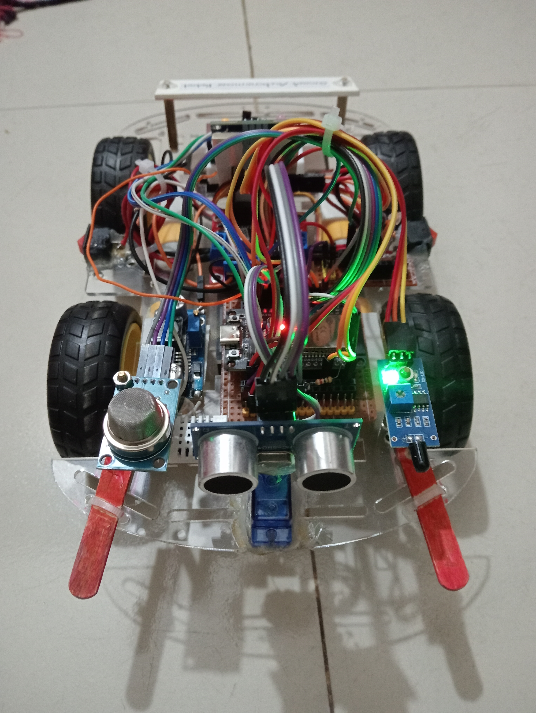

# 🤖 Smart Autonomous Fire and Gas Detection Robot

### 🚀 Intelligent Robotics • Embedded Systems • IoT • Environmental Safety

<p align="center">
  
</p>

An ESP32-powered autonomous robot that combines **obstacle avoidance, fire detection, gas monitoring, and real-time environmental sensing** in a single intelligent robotic platform.

Designed to explore the possibilities of robotics and IoT, this project integrates multiple sensors, an OLED display, an audible and visual alert system, and a Wi-Fi web dashboard for convenient monitoring.

<p align="center">
  
  
  
  
</p>

---

## 📑 Table of Contents

- [✨ Project Highlights](#-project-highlights)
- [🎯 Project Overview](#-project-overview)
- [⚙️ Key Features](#️-key-features)
- [🧰 Hardware Components](#-hardware-components)
- [🔌 Pin Configuration](#-pin-configuration)
- [🧠 Working Principle](#-working-principle)
- [🌐 Web Dashboard](#-web-dashboard)
- [💻 Software Requirements](#-software-requirements)
- [🚀 Installation and Setup](#-installation-and-setup)
- [🔮 Future Improvements](#-future-improvements)
- [⚠️ Safety Notice](#️-safety-notice)
- [👨‍💻 Author](#-author)
- [📜 License](#-license)

---

## ✨ Project Highlights

| Feature | Description |
|---|---|
| 🤖 Autonomous Movement | Moves forward and navigates around obstacles |
| 📡 Smart Obstacle Avoidance | Scans left and right to select a direction |
| 🔥 Fire Detection | Detects potential fire using a flame sensor |
| 💨 Gas Monitoring | Monitors gas-related changes using an MQ-2 sensor |
| 🌡️ Environmental Sensing | Measures temperature and humidity |
| 📟 OLED Interface | Displays robot status and sensor information |
| 🌐 IoT Dashboard | Monitors live sensor readings over Wi-Fi |
| 🚨 Alert System | Provides visual and audible warnings |

## 🎯 Project Overview

The **Smart Autonomous Fire and Gas Detection Robot** is an embedded robotics project built around the ESP32 microcontroller.

The robot combines autonomous movement with environmental monitoring. An ultrasonic sensor measures the distance to nearby obstacles, while a servo motor enables directional scanning. The robot uses the measured distances to choose a direction when navigating around an obstacle.

At the same time, the flame sensor and MQ-2 gas sensor monitor potential fire and gas-related hazards. A DHT22 sensor measures temperature and humidity, while an SH1106 OLED displays the current operating status.

A built-in web server makes sensor readings and robot status accessible through a browser over the same Wi-Fi network.

**The goal:** To explore how robotics, embedded systems, sensors, and IoT can work together in an intelligent mobile platform.

## ⚙️ Key Features

### 🤖 Autonomous Navigation
- Automatic forward movement.
- Ultrasonic obstacle detection.
- Servo-assisted left and right scanning.
- Automatic turning based on available space.
- Reverse movement when both scanned directions are blocked.
- Gradual motor speed adjustment for smoother movement.

### 🔥 Fire and Gas Detection
- Flame sensor for potential fire detection.
- MQ-2 sensor for gas and smoke-related sensing.
- Startup gas sensor baseline calibration.
- Independent fire and gas alert conditions.
- Dedicated red and yellow alert LEDs.
- Buzzer alerts when a hazard is detected.

### 🌡️ Environmental Monitoring
- DHT22 temperature measurement.
- DHT22 relative humidity measurement.
- Live sensor readings through the dashboard.
- OLED status display for convenient local monitoring.

### 🌐 Wi-Fi Web Dashboard
- Browser-based robot monitoring.
- Live robot operating status.
- Ultrasonic distance readings.
- Gas sensor values.
- Fire and gas alert indicators.
- Temperature and humidity readings.
- Automatic dashboard refresh every second.

---

## 🧰 Hardware Components

| Component | Function |
|---|---|
| ESP32 Development Board | Main controller and Wi-Fi connectivity |
| L298N Motor Driver | Controls DC motor direction and speed |
| DC Gear Motors | Drive the robot |
| Robot Chassis and Wheels | Mechanical platform |
| HC-SR04 Ultrasonic Sensor | Measures obstacle distance |
| SG90 or Compatible Servo | Rotates the ultrasonic sensor |
| MQ-2 Gas Sensor | Gas and smoke-related sensing |
| Flame Sensor Module | Potential fire detection |
| DHT22 Sensor | Temperature and humidity monitoring |
| SH1106 OLED (128×64) | Displays sensor readings and status |
| Buzzer | Audible alerts |
| Red LED | Fire alert indication |
| Yellow LED | Gas alert indication |
| Battery and Jumper Wires | Power and electrical connections |

---

## 🔌 Pin Configuration

The following table reflects the GPIO assignments used in the current firmware.

### Sensors and Display

| Device | ESP32 GPIO |
|---|---:|
| MQ-2 Analog Output | GPIO 34 |
| Flame Sensor Digital Output | GPIO 35 |
| DHT22 Data | GPIO 27 |
| Ultrasonic TRIG | GPIO 5 |
| Ultrasonic ECHO | GPIO 18 |
| Servo Signal | GPIO 13 |
| OLED SDA | Default ESP32 I²C SDA |
| OLED SCL | Default ESP32 I²C SCL |

### Motor Driver and Alerts

| L298N / Device | ESP32 GPIO |
|---|---:|
| ENA | GPIO 14 |
| IN1 | GPIO 26 |
| IN2 | GPIO 25 |
| ENB | GPIO 33 |
| IN3 | GPIO 32 |
| IN4 | GPIO 15 |
| Buzzer | GPIO 12 |
| Red LED | GPIO 4 |
| Yellow LED | GPIO 2 |

**Hardware note:** Verify your particular ESP32 board's I²C pin assignments. The HC-SR04 ECHO output may be 5 V and must be reduced to a safe ESP32 GPIO level using a voltage divider or suitable level shifter. Ensure all required grounds are connected together.

---

## 🧠 Working Principle

The robot operates through the following sequence:

1. **System Initialization** — Initializes the ESP32, sensors, motor driver, servo, OLED display, and Wi-Fi web server.
2. **Gas Sensor Calibration** — Allows an initial warm-up period and estimates a baseline before setting the gas detection threshold.
3. **Environmental Monitoring** — Reads flame sensor status, gas level, temperature, and humidity.
4. **Hazard Response** — Stops the motors when the configured fire or gas alert condition is detected and activates the corresponding alerts.
5. **Obstacle Detection** — Measures the forward distance using the ultrasonic sensor.
6. **Directional Scanning** — Moves the servo to scan the left and right sides when an obstacle is detected.
7. **Navigation Decision** — Chooses a direction based on the measured distances or reverses when both sides appear blocked.
8. **Smooth Movement** — Adjusts motor speed gradually when the path ahead is clear.
9. **Live Monitoring** — Updates the OLED display and serves sensor data to the Wi-Fi dashboard.

---

## 🌐 Web Dashboard

The integrated dashboard provides a convenient way to monitor the robot without connecting a serial monitor continuously.

### Available Monitoring Data

| Dashboard Element | Information |
|---|---|
| Current State | Robot's current operating state |
| Distance | Measured distance in centimeters |
| Gas Level | Raw MQ-2 analog reading |
| Fire Status | Normal or detected |
| Gas Status | Normal or detected |
| Temperature | Temperature in °C |
| Humidity | Relative humidity in % |
| Connection Indicator | Dashboard connection status |

### How to Access the Dashboard

1. Configure your Wi-Fi credentials in the firmware.
2. Upload the program to the ESP32.
3. Open the Serial Monitor at **115200 baud**.
4. Find the IP address printed after a successful Wi-Fi connection.
5. Connect your computer or phone to the same local network.
6. Enter the ESP32 IP address in your browser.

The dashboard retrieves sensor data from the robot's `/data` endpoint and refreshes automatically every second.

---

## 💻 Software Requirements

- **Arduino IDE** — Firmware development and uploading.
- **ESP32 Arduino Core** — Board support and networking.
- **C++** — Embedded firmware language.
- **U8g2** — OLED graphics and display support.
- **DHT sensor library by Adafruit** — Temperature and humidity sensing.
- **Adafruit Unified Sensor** — Sensor abstraction support.
- **ESP32Servo** — Servo motor control.
- **WiFi.h** and **WebServer.h** — ESP32 networking and HTTP server.
- **Wire.h** — I²C communication.

---

## 🚀 Installation and Setup

### Step 1 — Clone the Repository

Replace the placeholders with your GitHub username and repository name.

```bash
git clone https://github.com/ashfaqlabib/Smart-Autonomous-Fire-and-Gas-Detection-Robot.git
cd Smart-Autonomous-Fire-and-Gas-Detection-Robot
```

### Step 2 — Install the Libraries

Open Arduino IDE and install the following libraries using Library Manager:

- U8g2
- DHT sensor library by Adafruit
- Adafruit Unified Sensor
- ESP32Servo

Install the ESP32 board package and select the board that matches your hardware.

### Step 3 — Configure Wi-Fi

Update the credentials in the source code:

```cpp
const char* WIFI_SSID = "YOUR_WIFI_NAME";
const char* WIFI_PASSWORD = "YOUR_WIFI_PASSWORD";
```

Use your own network credentials. Never publish real Wi-Fi passwords in a public repository.

### Step 4 — Connect the Hardware

Connect the sensors, OLED display, servo, motor driver, buzzer, and LEDs according to the pin configuration above.

Check all supply voltages and motor driver connections before powering on the robot.

### Step 5 — Upload the Firmware

1. Connect the ESP32 to your computer using USB.
2. Select the correct board and port.
3. Verify the firmware.
4. Upload the code.
5. Open Serial Monitor at 115200 baud.

### Step 6 — Test the Robot

Test each subsystem individually before allowing autonomous movement:

- Check the OLED and sensor readings.
- Verify ultrasonic distance measurements.
- Test motor direction and turning.
- Verify fire and gas alert behavior.
- Connect to the Wi-Fi dashboard.
- Test obstacle avoidance in a clear, controlled area.

---

## 🔮 Future Improvements

This project can be extended with additional hardware and software capabilities:

- 🧭 PID-based movement and improved navigation.
- 🗺️ Smarter path planning and obstacle mapping.
- 📱 Mobile-friendly controls and manual driving mode.
- 📊 Historical sensor data logging and visualization.
- 🔋 Battery voltage monitoring and low-battery alerts.
- 📡 Remote monitoring beyond the local network.
- 🧪 More robust gas sensor calibration and fault detection.
- 🧠 Intelligent decision-making and advanced robotics algorithms.
- 📷 Camera integration for visual inspection.

---

## ⚠️ Safety Notice

This project is an educational robotics prototype, not a certified fire safety or gas detection system.

- MQ-2 readings are affected by sensor warm-up, calibration, and environmental conditions.
- Flame sensors may be affected by lighting and the environment.
- A missing ultrasonic echo does not guarantee that the path is clear.
- Test motor control and emergency-stop behavior before autonomous operation.
- Use certified safety equipment for real fire, smoke, or gas hazard protection.

Never rely on this robot as the sole means of protecting people or property.

---

## 👨‍💻 Author

**Ashfaq Labib**

*Embedded Systems | Robotics | ESP32 | Arduino | AI & Data Science*

I'm passionate about building practical projects that combine hardware, software, electronics, and intelligent automation.

🔗 **GitHub:** [github.com/ashfaqlabib](https://github.com/ashfaqlabib)

---

## 📜 License

Choose an appropriate open-source license for your project and include its full text in a `LICENSE` file. For example, the MIT License is a common choice for projects intended to allow reuse and modification.

---

<p align="center">
  <b>Built with curiosity, electronics, and a passion for robotics. 🤖</b>
  <br>
  ⭐ If you find this project interesting, consider giving the repository a star!
</p>
